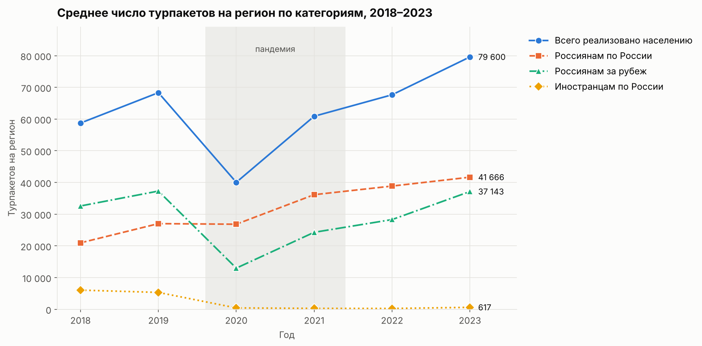
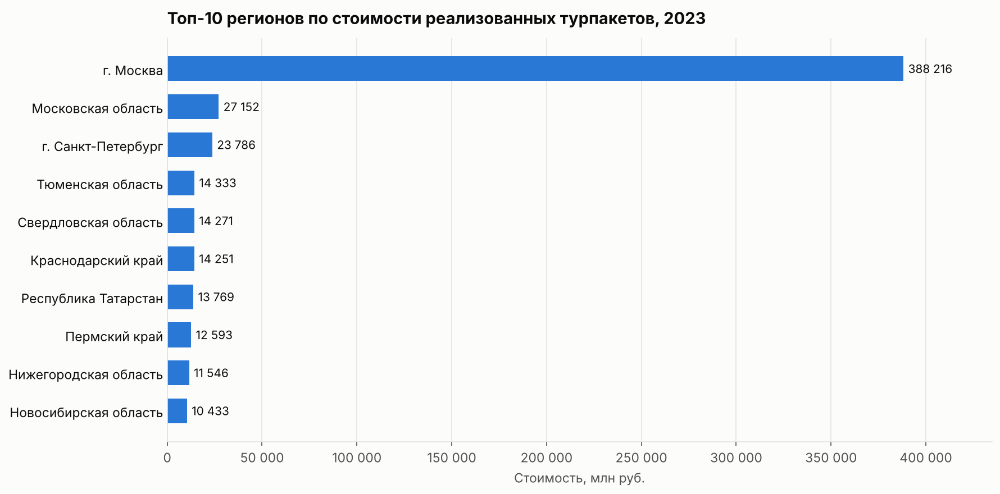
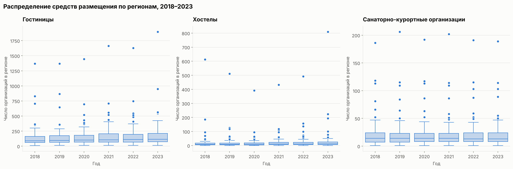
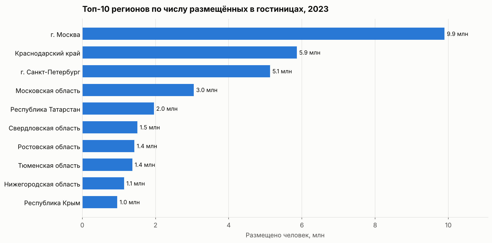

# Туризм в регионах России: исследование и проверка гипотез


Исследование рынка туризма по субъектам РФ за 2018–2023 годы для агрегатора отелей:
очистка статистики Росстата, исследовательский анализ и проверка двух бизнес-гипотез.

**[→ Открыть ноутбук с полным исследованием](notebooks/tourism_analysis.ipynb)**

## Главное

| | |
|---|---|
| **54,6%** | стоимости всех турпакетов страны приходится на Москву |
| **−0,7%** | изменение внутреннего туризма в 2020 году при общем падении рынка на 41% |
| **77%** | денег на рынке турпакетов — поездки за рубеж, хотя их продаётся меньше |
| **×10** | во столько раз сократились турпакеты для иностранцев с 2018 года |
| **+30%** | гостиниц в типичном регионе за 2018–2023 годы, хостелов — в полтора раза больше |



## Задача

Агрегатор отелей хочет предлагать пользователям персонализированные маршруты и строить маркетинг на данных.
Для этого нужно понять:

- в каких регионах продают больше всего турпакетов и размещают больше всего гостей;
- как менялся спрос на внутренний, выездной и въездной туризм;
- как распределены гостиницы, хостелы и санатории по регионам;
- подтверждаются ли гипотезы о стоимости турпакетов и росте внутреннего туризма.

## Выводы

### Рынок сверхконцентрирован

Москва даёт 54,6% всей стоимости реализованных турпакетов, топ-10 регионов — 74,5%.
Московская область на втором месте отстаёт от Москвы в 14 раз. Поэтому средние по стране
отражают в первую очередь столицу, и для «типичного» региона нужно смотреть на медианы.



### Внутренний туризм — самый устойчивый сегмент

В 2020 году продажи турпакетов упали на 41%, но почти целиком за счёт поездок за рубеж (−65%) и иностранцев (−92%).
Внутренний туризм почти не изменился, а к 2023 году вырос примерно вдвое относительно 2018-го.
Темп роста при этом замедлился до ~7% в год.

### Деньги — в выездном туризме

Внутренних турпакетов продаётся больше, но 77% стоимости приходится на поездки за рубеж:
такой турпакет в среднем намного дороже. Выездной туризм в 2023 году вернулся к уровню 2019-го.

### Средств размещения становится больше

Число гостиниц в медианном регионе выросло с 87 до 113 (+30%), хостелов — с 8 до 12, причём основной рост хостелов
пришёлся на 2022–2023 годы. Санаторно-курортный фонд за шесть лет не изменился. Лидер по гостиницам —
Краснодарский край (1 896, вдвое больше Москвы), по хостелам — Москва (809).



### Гостиницы живут внутренним спросом

Иностранцы составляют лишь 4,6% гостей. Краснодарский край второй по числу гостей, хотя по стоимости
турпакетов только шестой: на курорты часто едут самостоятельно и бронируют жильё напрямую.



### Проверка гипотез (α = 0.05)

| Гипотеза | Метод | Результат |
|---|---|---|
| Средняя стоимость турпакетов на регион в 2023 году > 800 млн руб. | одновыборочный t-тест + бутстреп, тест без Москвы, Уилкоксон | ✅ **Подтверждается.** t-тест на всех регионах: p = 0.049, на границе из-за Москвы. Остальные проверки — уверенно: даже медиана ≈ 2,5 млрд руб. |
| В 2023 году внутренних турпакетов продано больше, чем в 2022 | парный t-тест + Уилкоксон | ❌ **Не подтверждается.** Рост +9,9% и в 46 регионах из 78, но p = 0.097 (Уилкоксон — 0.071) |

Для второй гипотезы нужен **парный** тест: сравниваются одни и те же регионы в разные годы.
Тест для независимых выборок даёт здесь p = 0.43 — огромный разброс между регионами маскирует изменение внутри каждого.

### Рекомендации сервису

- **Внутренние направления — для охвата.** Массовый и устойчивый спрос. Развивать подборки жилья вокруг курортов
  (Краснодарский край, Крым, Алтай, Карелия), куда часто едут без турпакета.
- **Зарубежные направления — для выручки.** Поездок меньше, но они дороже и быстро растут: премиальные предложения, допродажи.
- **Сегментировать по регионам.** Москва и Санкт-Петербург — отдельный сегмент. Крупные регионы Урала, Поволжья и Сибири
  (Тюменская и Свердловская области, Татарстан, Пермский край) тоже входят в топ-10 рынка.
- **Планировать по медианам, а не средним** — средние по стране завышены Москвой.

## Работа с данными

Данные Росстата оказались «грязными», и это повлияло на выводы:

| Проблема | Решение |
|---|---|
| `…1` — значение скрыто из-за конфиденциальности, а не равно нулю | перевод в `NaN`; заполнение нулями занизило бы средние и исказило тесты |
| В таблице стоимости область записана трижды: целиком, её автономные округа и «без округов» | вложенные строки удалены, иначе деньги считаются дважды |
| Названия регионов различаются между файлами (`г.Москва` / `г. Москва`) | приведение к одному виду |
| В Москве и Московской области ~250–280 мест на хостел при типичных ~45 — вероятно, учтены общежития | вынесено как ограничение данных; на эти регионы приходится 71% всех мест в хостелах |
| Длинные кириллические названия столбцов с двойными пробелами | переименование по шаблону с проверкой незнакомых столбцов |
| Пропуски в турпакетах для иностранцев: почти в половине регионов таких продаж нет | расчёт по доступным значениям; в парном тесте — только регионы с данными за оба года |

Также проверены дубликаты, отрицательные значения и логическая согласованность таблиц.

## Данные

| Файл | Содержание |
|---|---|
| `hotel.csv` | число гостиниц, хостелов, санаторно-курортных организаций и мест в них, 2018–2023 |
| `count_person_hotel.csv` | число людей, размещённых в гостиницах, 2023 |
| `tour_firm.csv` | число реализованных турпакетов по категориям, 2018–2023 |
| `tour_cost_2023.csv` | стоимость реализованных турпакетов, 2023, млн руб. |

Источник — данные Росстата в материалах учебного проекта. Файлы лежат в `data/raw/` (разделитель `;`, UTF-8).

## Структура

```
russia-tourism-analysis/
├── notebooks/
│   └── tourism_analysis.ipynb   # исследование с выводами
├── src/
│   └── tourism.py               # загрузка и предобработка
├── data/raw/                    # исходные CSV
├── reports/figures/             # графики
└── requirements.txt
```

## Запуск

```bash
git clone https://github.com/EfimovAN18/russia-tourism-analysis.git
cd russia-tourism-analysis
python -m venv .venv && source .venv/bin/activate   # Windows: .venv\Scripts\activate
pip install -r requirements.txt
jupyter notebook notebooks/tourism_analysis.ipynb
```

## Стек

Python · pandas · NumPy · SciPy · matplotlib · seaborn · Jupyter

---

Автор: **Алексей Ефимов** — [github.com/EfimovAN18](https://github.com/EfimovAN18)
